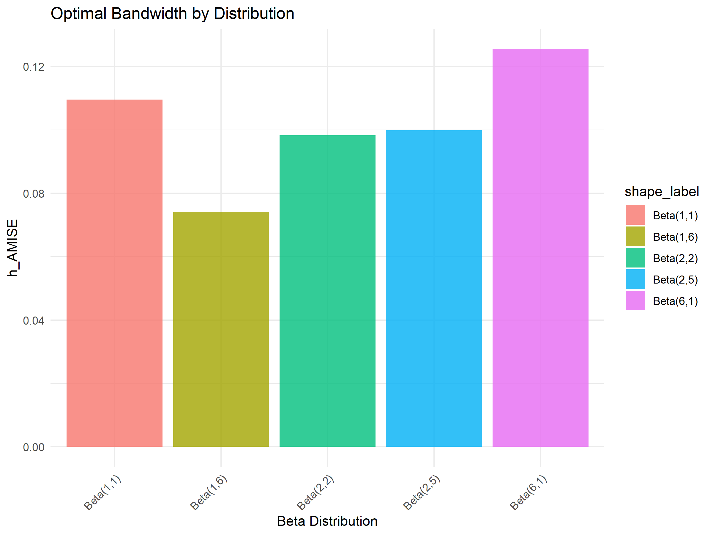
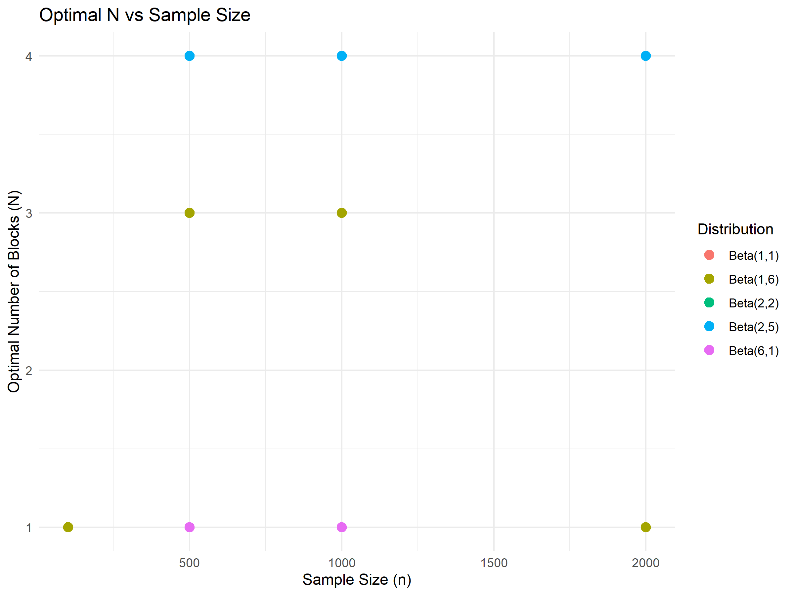
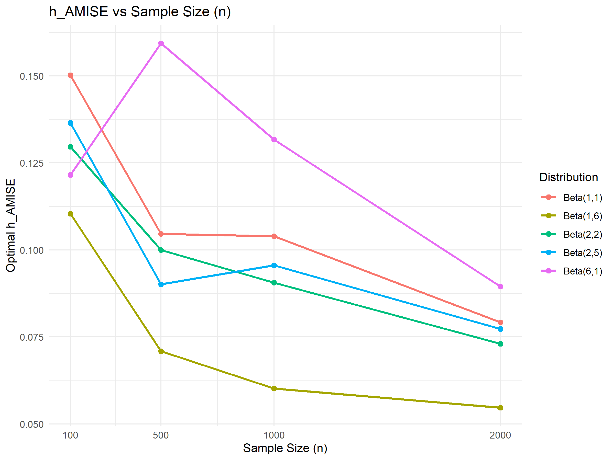

## Theoretical exercise

We are given i.i.d. samples $(x_i, y_i)$ from the model $y_i = m(x_i) + \varepsilon_i, \quad i=1, \dots, n$ and we estimate $m$ by the local linear estimator.

The local linear estimator at a target point $x$ is defined by $$ (\hat{\beta}_0(x), \hat{\beta}_1(x)) = \arg\min_{\beta_0,\beta_1 \in \mathbb{R}} \sum_{i=1}^n \bigl(Y_i - \beta_0 - \beta_1(X_i-x)\bigr)^2 K\left(\frac{X_i - x}{h}\right) .$$ The fitted value at $x$ is $\hat{m}(x) = \hat{\beta}_0(x).$

Let $K_i(x) = K\left(\frac{X_i - x}{h}\right).$ We minimize $$ Q(\beta_0, \beta_1) = \sum_{i=1}^n \bigl(Y_i - \beta_0 - \beta_1 (X_i - x)\bigr)^2 K_i(x). $$

This is a weighted least squares problem with weights $K_i(x)$.

Partial derivative with respect to $\beta_0$ $$ \frac{\partial Q}{\partial \beta_0} = -2 \sum_{i=1}^n K_i \big( Y_i - \beta_0 - \beta_1 (X_i - x) \big) = 0. $$ Thus $$ \sum_{i=1}^n K_i Y_i = \beta_0 \sum_{i=1}^n K_i + \beta_1 \sum_{i=1}^n (X_i - x) K_i. $$

Partial derivative with respect to $\beta_1$ $$ \frac{\partial Q}{\partial \beta_1} = -2 \sum_{i=1}^n(X_i - x) K_i \big( Y_i - \beta\_0 - \beta_1(X_i - x) \big) = 0. $$ Thus $$ \sum_{i=1}^n (X_i - x) K_i Y_i = \beta_0 \sum_{i=1}^n (X_i - x) K_i + \beta_1 \sum_{i=1}^n (X_i - x)^2 K_i.  $$

We want to solve for $\beta_0$.

$$\beta_1=\frac{ \sum_{i=1}^n K_i Y_i - \beta_0 \sum_{i=1}^n K_i }{\sum_{i=1}^n (X_i - x) K_i}$$

Now we substitute it into the other equation

$$ \sum_{i=1}^n (X_i - x) K_i Y_i = \beta_0 \sum_{i=1}^n (X_i - x) K_i + \frac{ \sum_{i=1}^n K_i Y_i - \beta_0 \sum_{i=1}^n K_i }{\sum_{i=1}^n (X_i - x) K_i} \sum_{i=1}^n (X_i - x)^2 K_i.  $$

We finally get

\begin{align*} \sum_{i=1}^n (X_i - x) K_i Y_i &= \beta_0 \sum_{i=1}^n (X_i - x) K_i + \frac{ (\sum_{i=1}^n K_i Y_i)\sum_{i=1}^n (X_i - x)^2 K_i }{\sum_{i=1}^n (X_i - x) K_i} -   \beta_0\frac{ (\sum_{i=1}^n K_i) \sum_{i=1}^n (X_i - x)^2 K_i }{\sum_{i=1}^n (X_i - x) K_i} \\
&= \beta_0 \left(\sum_{i=1}^n (X_i - x) K_i - \frac{ (\sum_{i=1}^n K_i) \sum_{i=1}^n (X_i - x)^2 K_i }{\sum_{i=1}^n (X_i - x) K_i}\right)+ \frac{ (\sum_{i=1}^n K_i Y_i)\sum_{i=1}^n (X_i - x)^2 K_i }{\sum_{i=1}^n (X_i - x) K_i}
 \end{align*}

Solving for $\hat{\beta}_0(x)$ gives $$ \hat{m}(x) = \hat{\beta}_0(x) = \frac{\big(\sum_i (X_i - x)^2 K_i(x)\big)\big(\sum_i K_i(x)Y_i\big) - \big(\sum_i (X_i - x) K_i(x)\big)\big(\sum_i (X_i - x) K_i(x) Y_i\big)} {\big(\sum_i K_i(x)\big)\big(\sum_i (X_i - x)^2 K_i(x)\big) - \big(\sum_i (X_i - x) K_i(x)\big)^2}. $$

Thus $\hat{m}(x)$ can be expressed as $$ \hat{m}(x) = \sum_{i=1}^n w_{ni}(x) Y_i, $$ with weights $$ w_{ni}(x) = \frac{\Big( \sum_{j=1}^n (X_i - x)^2 K_j(x) - (X_i - x) \sum_{j=1}^n (X_i - x)(x) K_j(x) \Big) K_i(x)} {\Big( \sum_{j=1}^n K_j(x) \Big)\Big( \sum_{j=1}^n (X_i - x)^2 K_j(x) \Big) - \Big(\sum_{j=1}^n (X_i - x) K_j(x)\Big)^2}. $$

To receive the expression with $S_{n,k}(x)$ we divide numerator and denominator by $n h$, we can rewrite the weights in terms of $S_{n,0}, S_{n,1}, S_{n,2}$ \begin{align*} w_{ni}(x) &=\frac{\Big(\frac{1}{nh} \sum_{j=1}^n (X_i - x)^2 K_j(x) - (X_i - x)\frac{1}{nh} \sum_{j=1}^n (X_i - x)K_j(x) \Big) K_i(x)} {nh \Big(\frac{1}{nh} \sum_{j=1}^n K_j(x) \Big)\Big( \frac{1}{nh}\sum_{j=1}^n (X_i - x)^2 K_j(x) \Big) - \Big(\frac{1}{nh}\sum_{j=1}^n (X_i - x) K_j(x)\Big)^2}\\
&= \frac{\big( S_{n,2}(x) - (X_i - x) S_{n,1}(x) \big) K_i(x)} {nh S_{n,0}(x) S_{n,2}(x) - nh(S_{n,1}(x))^2}. \end{align*}

Finally, summing over $i$ \begin{align*}
\sum_{i=1}^n w_{ni}(x) &= \frac{S_{n,2}(x) \sum_i K_i(x) - S_{n,1}(x) \sum_i (X_i - x) K_i(x)}{nhS_{n,0}(x)S_{n,2}(x) - nh(S_{n,1}(x))^2}\\
&= \frac{S_{n,2}(x) nhS_{n,0}(x) - S_{n,1}(x)( nhS_{n,1}(x))}{nhS_{n,0}(x)S_{n,2}(x) - nh(S_{n,1}(x))^2} \\
&= \frac{S_{n,2}(x)S_{n,0}(x) - (S_{n,1}(x))^2}{S_{n,0}(x)S_{n,2}(x) -(S_{n,1}(x))^2} \\
&=1
\end{align*}

## Practical exercise

In this simulation study, we investigated the behavior of the AMISE bandwidth, as a function of the number of blocks N, the sample size n, and the distribution $X\sim \text{Beta}(\alpha,\beta)$. The response was generated as $Y=m(X)+\varepsilon$, with $m(x)=sin⁡((x/3+0.1)^{−1}$ and $\varepsilon \sim N(0,1)$. We considered Beta distributions with shapes Beta(1,1), Beta(2,2), Beta(2,5), Beta(1,6), and Beta(6,1) and sample sizes of 100, 500, 1000, and 2000. For each dataset, $hAMISE$ was estimated using block-wise quartic polynomial fits, and the optimal number of blocks N was selected via Mallows’Cp criterion.

The relationship between $hAMISE$ and the number of blocks N varied across distributions. For Beta(6,1), the bandwidth decreased noticeably as N increased, whereas for the other Beta shapes it remained almost stable.


When comparing optimal bandwidths across distributions, Beta(1,6) produced the smallest optimal h (around 0.07), while Beta(6,1) gave the largest (around 0.13), reflecting the influence of uneven observation density on curvature estimation and smoothing.





The optimal number of blocks selected by Mallows’Cp showed some variation but no strong systematic connection with the sample size. For n=200, all distributions had an optimal N of 1, while at n=500, the optimal N ranged between 1, 3, or 4 depending on the Beta shape, and at n=2000, it was either 1 or 4. This indicates that the main requirement for selecting an appropriate N is that the sample size be large enough to allow reliable block-wise polynomial fits, rather than following a strict dependence on n.




Finally, plotting $hAMISE$ against sample size for the Cp-optimal number of blocks revealed a clear decreasing trend across all Beta shapes, confirming that larger datasets allow for smaller smoothing bandwidths due to more precise curvature estimation.





Overall, the study demonstrates that both the covariate distribution and the number of blocks influence bandwidth selection, with skewed distributions and uneven observation densities leading to wider variability in hAMISE, whereas the sample size primarily governs the precision of the estimates and the feasibility of using multiple blocks.

```{r}
#| echo: false
#| message: false
#| warning: false

# Your code goes here. 
# The `echo: false` option disables the printing of code (only output is displayed).
# The programming language can be changed to Python or Julia

```
